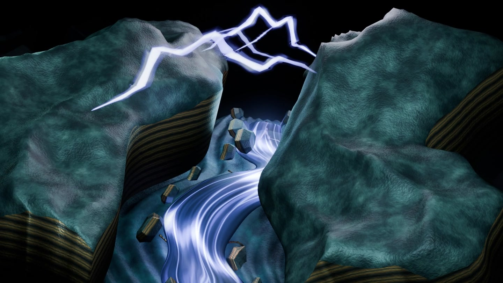
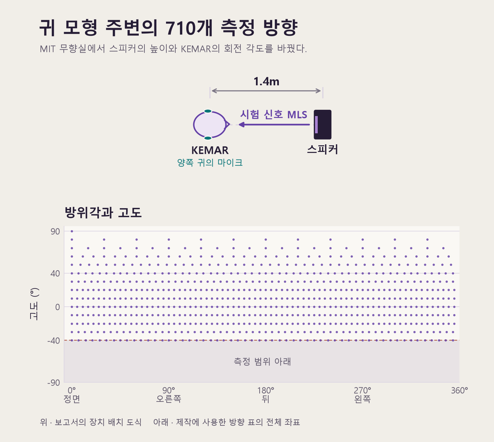
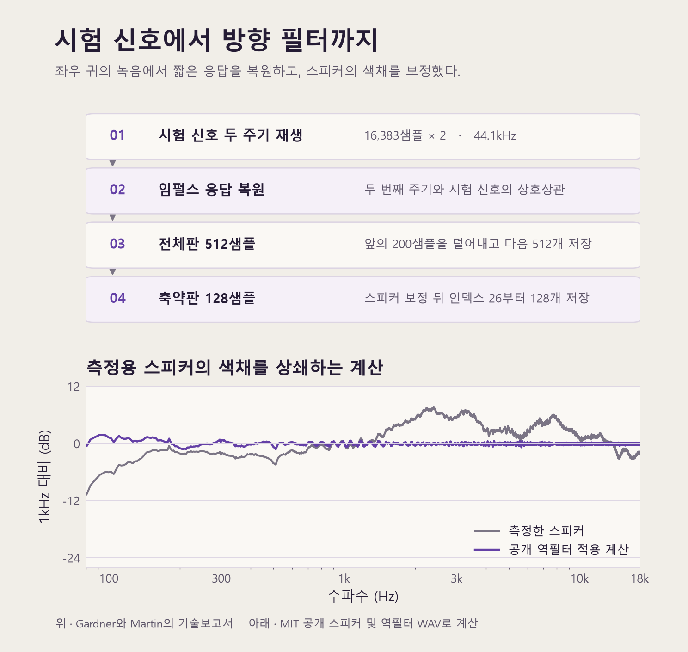
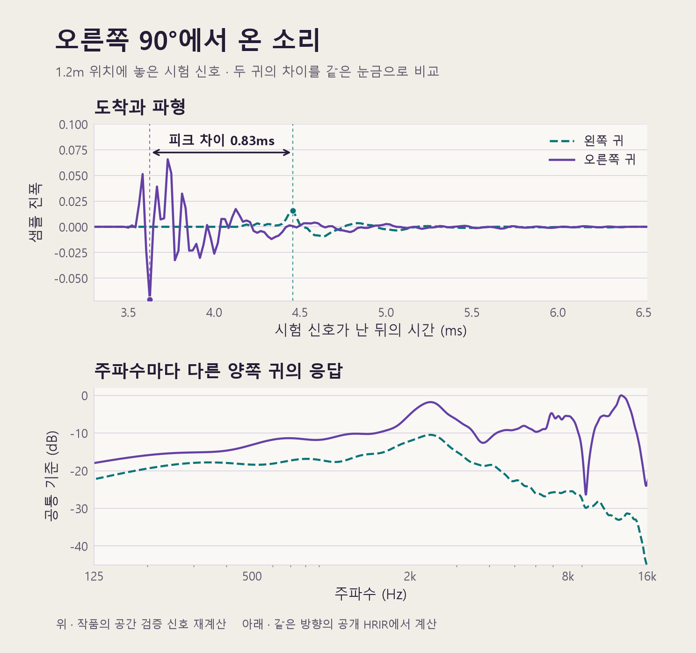
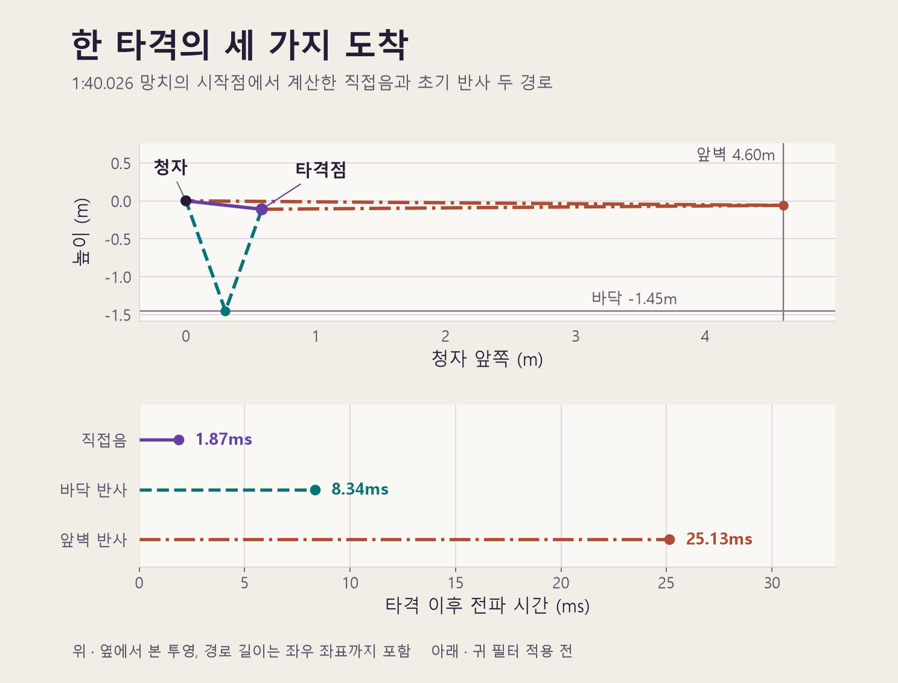
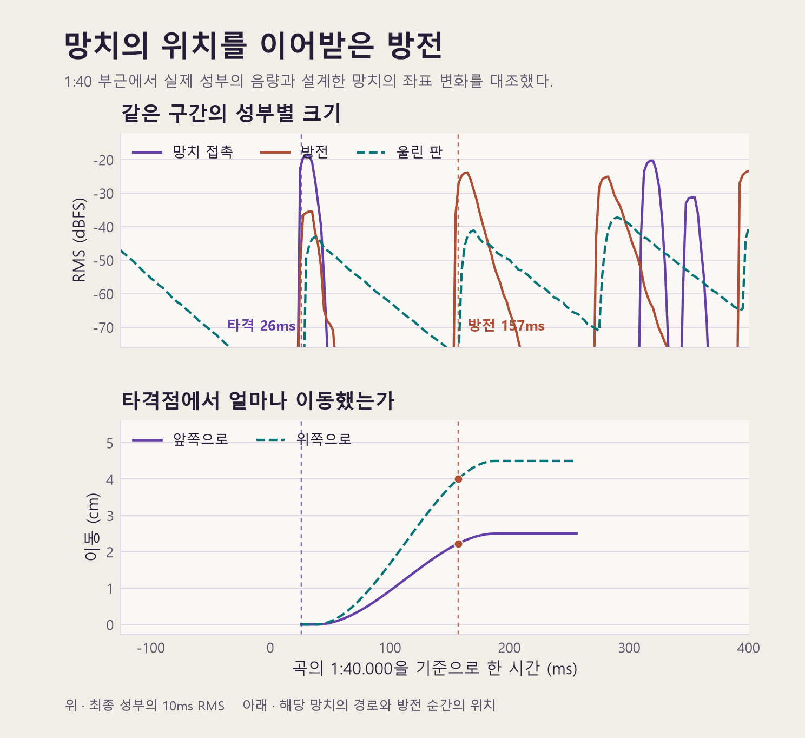
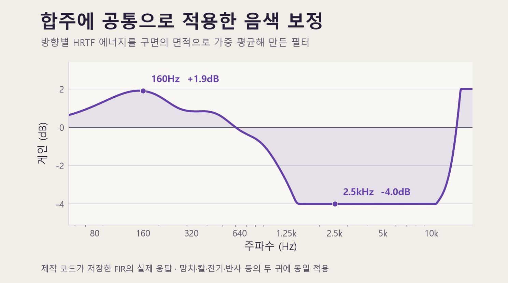

## Ⅰ. 《절단 전압》의 공간 구상과 MIT의 귀 모형 데이터

[앞선 글](/distilling-sound-and-building-images)에서 나는 한 곡의 소리를 증류해 다음 곡을 연주할 악기로 삼아 온 과정을 적었다. 그동안의 작업이 소리의 질감과 시간적 인과관계를 빚는 데 집중했다면, 새 테크노 작품인 《절단 전압》을 구상하면서는 소리가 놓이는 ‘자리’ 자체가 악보의 일부가 되기를 바랐다. 일정한 테크노의 박이 몸의 중심을 잡아 주는 동안, 망치는 울릴 때마다 귀 가까이 다가왔다가 한 걸음 물러서고, 칼은 표면과 마찰을 일으키며 경로를 따라 이동하고, 전기는 그 주변을 흐르다가 망치나 칼이 방금 지나간 바로 그 자리에서 방전을 시작하는 음악을 만들고 싶었다.

이번에도 망치와 칼, 전기의 소리 몸체는 우리가 직접 만들어 둔 악기 보관함에서 출발했다. 문제는 그 소리가 두 귀에 도달하는 공간을 어떻게 설득력 있게 구현하느냐였다. 트랙의 음량이나 단순한 좌우 배분만 조절해서는 타격이 정면에서 왔는지 등 뒤에서 돌아왔는지, 머리 위에서 내려왔는지 바닥 쪽에서 올라왔는지를 귀에 납득시킬 수 없었다. 예전 습작에서 간단한 시간차 수식만으로 입체 이동을 시험해 보았을 때도, 코드 위에 계산된 궤적이 있다는 사실과 실제 귀에 위치감이 자연스럽게 들리는 일 사이에는 분명한 간극이 있었다.

그 간극을 메우기 위해 나와 GPT가 선택한 방법은 실제 사람의 귀 모형으로 측정한 음향학 연구 자료를 제작 공정에 직접 들이는 일이었다. 우리가 찾은 자료는 작품 크레딧에도 이름을 올린 Bill Gardner와 Keith Martin이 1994년 MIT 미디어랩에서 구축한 **KEMAR HRTF 측정 데이터**다. 이미 만들어진 공간감 플러그인을 걸어 쓰는 방식으로는 성부마다 미세하게 달라지는 이동 경로와 방전 위치의 인계를 직접 통제하기 어려웠다. 그래서 우리는 연구진이 남긴 기술보고서와 원본 측정 파일의 구조를 처음부터 함께 읽으며, 실험실의 측정값을 우리 곡의 공간 합성 코드로 옮기는 작업부터 시작했다.

<figure style="margin: 1.65rem 0;">
  
  <figcaption>《절단 전압》 뮤직비디오 〈전기의 강〉의 2분 55초대 장면. 영상에서는 전도와 방전 성부의 움직임을 골짜기의 물길과 암벽 위의 방전으로 옮겼다.</figcaption>
</figure>

## Ⅱ. MIT의 귀 모형 데이터를 우리 작업 규격으로 옮기기

MIT 자료를 코드로 불러오기 전에 먼저 확인해야 했던 것은 이 데이터가 사람의 어떤 청각 단서를 어떻게 기록하고 있는가였다. 오른쪽에서 금속을 두드리면 소리는 오른쪽 귀에 먼저 도착하고, 머리를 돌아 왼쪽 귀로 넘어가는 동안 주파수 대역마다 서로 다른 비율로 줄어든다. 이러한 양이 시간차(ITD)와 양이 레벨차(ILD)에 더해, 귓바퀴의 굴곡이 입사 각도에 따라 특정 주파수를 강조하거나 깎아내면서 정면과 뒤쪽, 위와 아래를 구분하는 단서를 만든다.

Gardner와 Martin은 이 물리적 변화를 포착하기 위해 MIT 무향실에 머리와 몸통을 갖춘 음향 측정 모형인 **KEMAR**를 세우고, 양쪽 귓속에 장착한 Etymotic ER-11 마이크로 1.4m 거리의 Optimus Pro 7 스피커 소리를 16비트, 44.1kHz 규격으로 동시 녹음했다. 스피커 높이를 고정한 채 전동 회전대로 모형을 돌려가며 수평면 부근에서는 5도 간격으로 72곳을 재고, 원이 좁아지는 고도 80도에서는 12곳, 정수리 위 90도에서는 한 곳을 재어 고도 −40도부터 90도까지 총 **710개 방향의 양이 응답**을 남겼다. 제작 코드에서 이 방향 좌표들을 펼쳐 확인해 보니(그림 1), 회전 장치의 구조상 고도 −40도보다 낮은 영역은 비어 있다는 점이 눈에 들어왔다. 이 측정 범위의 하한선은 나중에 우리가 바닥 반사음을 설계할 때 별도의 보완 규칙을 세우는 근거가 되었다.

<figure style="margin: 1.65rem 0;">
  
  <figcaption>그림 1. 위는 MIT 무향실 측정 배치 도식이고, 아래는 우리 제작 코드에서 읽어 들인 710개 측정 방향의 좌표 분포다. 점 하나가 하나의 방위각과 고도를 나타낸다.</figcaption>
</figure>

측정 좌표를 파악한 뒤에는 공개된 여러 파일 가운데 어느 판본을 실제 공간 필터로 쓸지 결정해야 했다. 짧은 기준 신호에 대한 귀의 시간 파형인 **HRIR**(머리 관련 임펄스 응답)과 이를 푸리에 변환해 주파수별 크기·위상으로 나타낸 **HRTF**(머리 전달 함수)는 같은 현상의 두 표현인데, 악기가 실시간으로 움직이는 우리 작업에서는 시간 파형인 HRIR을 직접 필터로 읽는 편이 적합했다.

보고서를 따라가 보니 이 짧은 시간 파형이 어떤 정제 과정을 거쳐 배포되었는지 명확히 알 수 있었다. 연구진은 Rife와 Vanderkooy가 정립한 **MLS(Maximum Length Sequence, 최대 길이 수열)** 측정법에 따라, 귀에는 잡음처럼 들리지만 컴퓨터는 순서를 알고 있는 16,383샘플 수열을 두 주기 연속 재생하고 안정된 두 번째 주기를 원신호와 상호상관 연산해 응답을 복원했다(정면 왼쪽 귀 기준 신호 대 잡음비 약 65dB). 거기서 공기 전파 지연(약 180샘플)과 장비 지연(약 50샘플)이 섞인 앞쪽 200샘플을 덜어내고 512샘플을 남긴 것이 전체판이다. 다만 귓속 마이크 기록에는 실험용 스피커 자체의 음색까지 묻어 있으므로, 연구진은 스피커 응답을 따로 재어 18kHz까지 크기와 위상을 뒤집는 역필터를 만들었고, 공간 합성용 축약판에는 **최소 위상 역필터**를 적용해 인덱스 26부터 128샘플만 추려 담았다(헤드폰 네 종류의 응답도 별도 자료로 함께 남겼다). 우리가 공개 파일로 이 보정 전후를 직접 계산해 확인해 보니(그림 2) 측정 스피커의 대역별 굴곡이 평탄하게 정리되어 있었고, 덕분에 우리는 이 128샘플 축약판을 합성 엔진의 기초 자료로 채택했다.

<figure style="margin: 1.65rem 0;">
  
  <figcaption>그림 2. 회색 선은 MIT가 별도로 측정한 스피커 응답이고, 보라색 선은 그 파일에 공개 최소 위상 역필터를 적용해 우리가 확인한 결과다. 두 곡선 모두 1kHz를 0dB 기준으로 맞추어 대역별 변화를 비교했다.</figcaption>
</figure>

이 축약판을 우리 곡에 맞게 펼치는 과정에서도 연구진의 대칭 구성을 그대로 활용했다. 당시 실험 모형은 왼쪽에 표준형 귓바퀴를, 오른쪽에 더 큰 귓바퀴를 달고 있었기 때문에 연구진은 합성용 축약판을 만들면서 **왼쪽 귀의 실측값을 좌우 대칭으로 짝지어** 표준형 귓바퀴 한 쌍을 갖춘 모형으로 정리해 두었다. 음원이 오른쪽 90도에 있을 때 왼쪽 귀에는 실제 왼쪽 귀 기록을 쓰고, 오른쪽 귀에는 음원을 왼쪽 90도에 두었을 때의 왼쪽 귀 기록을 가져오는 방식이다.

나와 GPT는 이렇게 정리된 축약판의 좌우 응답 **368쌍**을 읽어 들인 뒤, 반대편 방향은 두 귀의 응답을 맞바꾸어 전체 710개 방향을 복원하고 작업 규격인 48kHz로 재표본화했다. 모든 방향과 좌우 채널에 동일한 변환을 거쳐 완성한 최종 응답 표는 **710방향 × 2귀 × 140샘플** 크기다. 본 작업에 들어가기에 앞서 이 응답 표로 **오른쪽 90도, 거리 1.2m** 위치의 시험 신호를 합성해 검증해 보았을 때(그림 3), 오른쪽 귀의 진폭 피크가 왼쪽보다 약 **0.83밀리초** 앞서 도착하고 전체 에너지도 약 **13.4dB** 높게 나타났으며 대역별 양이 차이도 의도대로 분리되었다. 연구실의 측정 자료가 비로소 우리 곡을 연주할 준비를 마친 순간이었다.

<figure style="margin: 1.65rem 0;">
  
  <figcaption>그림 3. 완성한 응답 표를 바탕으로 오른쪽 90도, 1.2m 조건에서 재계산한 양쪽 귀의 도착 파형(위)과 주파수 응답(아래). 보라색 실선이 오른쪽 귀, 청록색 점선이 왼쪽 귀를 나타낸다.</figcaption>
</figure>

## Ⅲ. 움직이는 망치와 칼에 실시간 귀 응답 입히기

고정된 방향의 응답 표가 준비되었지만, 《절단 전압》 안의 악기들은 한자리에 멈춰 있지 않는다. 우리는 먼저 자체 악기 보관함에서 원천 재료를 골라 `Pure Data`로 소리의 물리적 층위를 세공했다. 망치는 표면에 처음 닿는 타격 성분과 뒤이어 울리는 금속 몸체를 분리했고, 칼은 표면을 따라 이동하는 마찰음과 표면이 끊어지는 순간을 나누어 다듬었다. 그다음 Python에서 성부마다 출발 좌표와 이동 궤적을 부여했다. 망치는 타격 직후 약 12밀리초 동안 자리를 유지하다가 반동을 따라 움직이고, 칼은 기본 경로에서 안쪽으로 최대 22cm까지 휘어 들어가며 높이도 함께 바뀐다. 같은 악기 안에서도 첫 접촉과 뒤따르는 몸체가 서로 다른 운동을 그리도록 설계한 것이다.

이 움직임을 앞선 KEMAR 응답 표와 연결하기 위해 청자를 원점에 두고 정면, 오른쪽, 위쪽을 각각 x, y, z축의 양의 방향으로 잡았다. 매 시각 음원 좌표에서 청자까지의 거리 r과 방위각, 고도를 구한 뒤 음속을 초당 343m로 놓아 소리 발생 시각에 전파 지연인 **r ÷ 343초**를 더했고, 직접음의 크기는 **1.2 ÷ r**을 따르되 귀 가까이에서 과도하게 커지지 않도록 상한을 2.1배로 두었다. 음원이 이동하는 동안 거리 r이 매 순간 변하므로, 출력 파형의 각 샘플마다 어느 시점에 출발한 소리가 지금 귀에 도착하는지를 역산해 읽어 들였다.

도착 각도에 대응하는 귀 필터 역시 이동 경로를 따라 매 시각 보간했다. 가령 고도 −10도, 오른쪽 22도에서 소리가 들어오는 순간에는 같은 고도의 오른쪽 20도 응답을 60%, 25도 응답을 40% 비율로 섞고, 높이가 측정된 두 고도 사이에 걸치면 위아래 고도에서 각각 계산한 값을 다시 높이에 따라 섞어 최대 네 방향의 실측 응답이 한 시점의 140샘플 필터를 이루게 했다. 출력 샘플마다 도착 파형과 이 140개의 필터 계수를 곱해 더하는 **합성곱**(컨볼루션) 과정에서 계수가 매 샘플 갱신되기 때문에, 칼의 마찰음이 한쪽 귀에서 반대편으로 이동할 때 음량과 양이 시간차, 주파수 윤곽이 하나의 연속된 움직임으로 함께 변한다.

## Ⅳ. 무향실 바깥의 공간을 짓기: 영상 음원법과 측정 한계 보완

KEMAR 응답을 입히자 망치와 칼이 머리 주변 어느 각도에서 움직이는지는 또렷해졌지만, 무향실에서 측정한 자료만으로는 소리가 허공에 떠 있는 듯한 인상이 남았다. 타격의 무게가 공간 안에 발을 붙이려면 망치가 울린 뒤 주변의 벽과 바닥이 그 소리를 어떻게 되돌려 주는지도 함께 설계해야 했다.

이를 위해 우리가 끌어들인 두 번째 연구 자료가 Allen과 Berkley가 1979년 논문에서 정립한 **영상 음원법**(Image-Source Method)이다. 실제 음원의 위치를 벽면 너머로 거울처럼 대칭 이동시키면, 그 가상 음원에서 청자까지의 직선거리가 벽을 한 번 짚고 돌아오는 실제 반사 경로의 길이와 일치한다. 원논문은 직육면체 방 안의 다중 반사까지 계산하지만, 우리는 타격의 위치감이 긴 잔향에 흐려지지 않도록 앞뒤 벽과 좌우 벽, 바닥과 천장에서 한 번씩만 돌아오는 1차 초기 반사만을 망치와 칼에 적용했다.

곡의 **1:40.026**에 들어오는 망치 타격이 이 두 연구 자료가 만나는 방식을 잘 보여준다(그림 4). 정면 58.4cm, 오른쪽 23.6cm, 귀 높이 아래 11.1cm(직선거리 약 64cm)에서 출발한 직접음은 약 1.87밀리초 만에 청자에게 닿는다. 같은 타격이 바닥을 한 번 거치면 경로가 2.859m로 늘어나 약 8.34밀리초 뒤에 도착하고, 앞벽을 거치면 8.620m를 이동해 약 25.13밀리초 뒤에 도착한다. 우리는 각 반사 경로마다 거리 감쇠와 반사면의 대역 필터를 거친 뒤, 그 반사음이 진입하는 각도의 KEMAR 좌우 귀 응답을 입혔다.

<figure style="margin: 1.65rem 0;">
  
  <figcaption>그림 4. 1분 40.026초 망치 타격의 직접음과 두 초기 반사 경로를 옆모습으로 투영한 도식(위)과 세 소리의 도착 시각(아래). 실제 거리와 시간 계산에는 좌우 좌표까지 모두 반영했다.</figcaption>
</figure>

바로 이 지점에서 앞서 그림 1을 확인하며 눈여겨보았던 측정 범위의 한계와 마주쳤다. 바닥에서 반사되어 올라오는 소리는 기하학적으로 귀 아래 약 77도 각도에서 진입하는데, MIT 자료의 측정 하한선은 고도 −40도에서 끝나기 때문이다. 우리는 이 문제를 해결하기 위해 물리적 공간의 시간과 귀 모형의 각도 범위를 분리해 다루었다. **반사 경로의 이동 거리와 도착 지연 시간(8.34밀리초)은 영상 음원법의 기하학적 계산값을 그대로 유지하고, 귀의 방향 필터에만 측정 범위 안에서 가장 가까운 −40도 고도의 응답을 적용**한 것이다. 금속 몸체 자체의 감쇠와 바닥·앞벽에서 시차를 두고 돌아오는 반사 시간을 분리해 둔 덕분에, 타격 순간의 선명한 윤곽을 유지하면서도 가까운 바닥과 먼 앞벽이 만드는 공간의 크기를 세밀하게 조율할 수 있었다.

## Ⅴ. 타격의 좌표를 전기가 이어받는 작곡 구조

망치와 칼이 현실적인 공간 좌표를 얻고 나자, 처음 구상했던 핵심 장면인 ‘방금 타격이 일어난 자리에서 시작되는 전기’를 구체적인 코드로 엮을 수 있었다. 우리는 전기 성부에 시간과 공간 두 갈래의 인과 계산을 심었다. 먼저 **언제 방전할 것인가**를 정하기 위해, 망치와 칼이 실제로 출력한 오디오 파형을 읽어 전류의 축적 상태와 방전 문턱값을 계산하고 그 제어 신호로 `Pure Data` 회로가 지속 전류음과 순간적인 방전, 뒤따라 공명하는 금속판 소리를 내도록 했다. 망치와 칼의 입력을 0으로 비운 대조 실험에서 방전 기록이 685회에서 497회로 줄어든 것을 확인하며 접촉 성부가 전기 발생을 실제로 이끌고 있음을 점검했다.

여기에 **어디에서 방전할 것인가**를 결정하는 좌표 인계 규칙을 결합했다. 방전 직전 0.8초 안에 물리적 접촉이 있었다면 가장 최근에 작동한 망치나 칼을 찾아, 방전 시각까지 그 물체가 설계 궤적을 따라 얼마나 이동했는지를 읽어낸다. 앞서 살핀 **1:40.026** 망치 타격에 이어지는 **1:40.157**의 방전이 그 예다(그림 5). 이때 망치는 타격 지점에서 반동을 타고 앞으로 약 2.2cm, 위로 약 4.0cm 움직인 상태이며, 전기는 정확히 그 이동한 좌표를 이어받아 방전을 시작한다. 전기에 반응해 울리는 금속판에는 청자의 왼쪽 뒤편 아래에 별도의 고정 좌표를 주어 앞쪽의 방전과 입체적인 대구를 이루게 했다.

<figure style="margin: 1.65rem 0;">
  
  <figcaption>그림 5. 최종 프로젝트의 세 성부를 10밀리초 단위로 계산한 평균 신호 크기(위)와 해당 망치의 이동 궤적(아래). 세로 점선은 타격 시각(26ms)과 방전 시각(157ms)을 표시하며, 위쪽 곡선에는 인접한 다른 타격과 방전도 함께 담겨 있다.</figcaption>
</figure>

이처럼 상부 성부들이 사방으로 좌표를 바꾸며 주고받는 동안, 테크노로서의 중심축이 흔들리지 않도록 144 BPM, 4/4박자의 바닥 박은 정가운데에 고정했다. 베이스 역시 120Hz 저역 통과 필터 아래의 저음은 양쪽 귀에 동일한 신호로 묶어 무게중심을 잡고, 배음이 실리는 상부 성분만 공간에서 움직이도록 나누었다. 곡의 1분 20초대에 막과 탄성 금속 성부가 무게를 나누어 받다가 1분 40초에 네 박의 배치가 복귀할 때, 가까이 다가오는 망치와 그 자리를 이어받는 전기가 나란히 전면에 들어오며 리듬의 귀환과 공간의 인계가 한 문장으로 맞물린다.

## Ⅵ. 연구 자료의 역필터 발상을 합주 음색 보정에 응용하기

공간 경로와 성부 간 인계를 모두 엮어 초기 합주본을 들어 보았을 때, 위치의 움직임과는 별개로 전체 음향이 다소 답답하고 성부들이 뭉쳐 들리는 문제가 드러났다. 주파수 대역별 에너지를 분석해 보니 망치 에너지의 약 97%가 120–700Hz 구간에 몰려 지속 전류음 및 배경 질감과 부딪치고 있었고, 여러 방향의 HRTF를 겹쳐 쓰는 과정에서 귀 모형 특유의 대역별 강조도 누적되고 있었다.

이 문제를 풀 때 앞서 MIT 보고서에서 살폈던 역필터 보정 방식(그림 2)이 좋은 실마리가 되었다. 연구진이 측정용 스피커의 고유 색채를 평탄하게 덜어냈듯, 우리도 **공간 합성을 마친 합주 전체의 평균적인 색채 치우침**을 완만하게 보정하기로 한 것이다. 망치의 첫 접촉과 금속 몸체의 감쇠를 새로 다듬는 동시에, 710개 방향의 HRTF 에너지를 각 방향이 구면에서 대표하는 면적만큼 가중 평균해 감쇠 최대 4dB, 증폭 최대 2dB 범위의 공통 음색 필터를 설계했다(그림 6). 망치, 칼, 전기, 초기 반사 성부의 좌우 채널에 동일하게 건 이 필터로 160Hz 부근은 약 1.9dB 보강하고 2.5kHz 부근은 약 4dB 낮추었으며, 그 위로 성부끼리 겹치는 중역과 순간적으로 날카로워지는 대역을 개별 조율한 뒤 16개의 스테레오 성부를 `PhaseLab`에 모아 48kHz, 24비트 WAV로 완성했다.

<figure style="margin: 1.65rem 0;">
  
  <figcaption>그림 6. 공간 성부들에 공통으로 적용한 합주 음색 보정 필터의 실제 주파수 응답. 0dB 기준선 위쪽은 증폭, 아래쪽은 감쇠를 뜻한다.</figcaption>
</figure>

## Ⅶ. 파형의 검증과 귀가 내리는 최종 판단

마스터 파일을 출력한 뒤에는 연구 자료를 바탕으로 짠 공간 연산이 실제 오디오 파형에 오차 없이 들어갔는지 검증했다. 오른쪽 90도 시험 신호를 왼쪽 90도로 옮겨 그림 3의 시간·에너지 관계가 정확히 뒤집히는 것을 확인했고, 정면·후면·상부를 포함한 여섯 고정 위치와 연속 이동 경로도 별도의 기준 계산과 샘플 단위로 대조했다. 그림 5를 그릴 때도 해당 구간의 16개 성부에 최종 마스터 게인을 적용해 더한 파형이 승인된 마스터 WAV와 일치하는지 확인해, 코드 속 좌표와 그래프의 성부가 실제 완성 음원과 정확히 대응하도록 점검했다.

《절단 전압》에서 직접음이 움직이는 거리는 약 0.62m에서 3.00m 사이다. 우리는 1.4m에서 측정된 KEMAR 방향 응답 위에 이동에 따른 거리 감쇠와 도달 지연을 별도로 계산해 얹어, 한자리에 머리를 고정한 청자 기준의 헤드폰용 스테레오로 이 곡을 완성했다. 물론 듣는 사람마다 귓바퀴의 생김새와 헤드폰의 특성이 모형과 다른 만큼 가까움이나 높낮이, 앞뒤 깊이를 체감하는 정도는 조금씩 달라질 것이다. 음향학 논문과 실측 데이터는 막연했던 공간적 상상을 통제 가능한 음악 구조로 바꾸어 주는 구체적인 토대가 되어 주었지만, 마지막까지 곡을 반복해 들으며 내가 귀로 판단해야 했던 질문은 결국 음악 자체에 있었다. 자리가 끊임없이 바뀌는 움직임 속에서도 중심 박이 안정적으로 버텨 주는지, 두꺼운 합주 안에서 타격의 윤곽이 선명하게 살아 있는지, 그리고 짧은 시차 뒤에 도착하는 방전이 방금 지나간 망치의 자리를 기억하게 만드는지였다.

---

### 참고한 연구와 그림의 근거

- Bill Gardner와 Keith Martin. *HRTF Measurements of a KEMAR Dummy-Head Microphone*. MIT Media Lab Perceptual Computing Technical Report No. 280, 1994. 무향실 측정, MLS 처리, 스피커 역필터 보정, 전체판과 축약판 구성의 근거. 동일 연구의 학술지 발표본은 *HRTF Measurements of a KEMAR*, *Journal of the Acoustical Society of America* 97권 6호, 3907–3908쪽, 1995.
- William G. Gardner. *3-D Audio Using Loudspeakers*. MIT 박사학위 논문, 1997. 공간 청각 단서와 머리 전달 함수의 시간·주파수 표현.
- Douglas D. Rife와 John Vanderkooy. *Transfer-Function Measurement with Maximum-Length Sequences*. *Journal of the Audio Engineering Society* 37권 6호, 419–444쪽, 1989. MLS 시험 신호와 상호상관을 이용한 임펄스 응답 복원.
- Jont B. Allen과 David A. Berkley. *Image Method for Efficiently Simulating Small-Room Acoustics*. *Journal of the Acoustical Society of America* 65권 4호, 943–950쪽, 1979. 영상 음원법을 이용한 실내 초기 반사 경로 계산.
- 그림 1–3은 위 기술보고서의 실험 절차와 공개 측정 자료, 그리고 작품 제작 코드의 시험 신호를 바탕으로 작성했다. 그림 4–6은 《절단 전압》의 최종 좌표 기록과 오디오 성부, 실제 적용 필터에서 추출해 그렸다. 대표 이미지는 자체 제작한 뮤직비디오 〈전기의 강〉의 완성 프레임이다.
